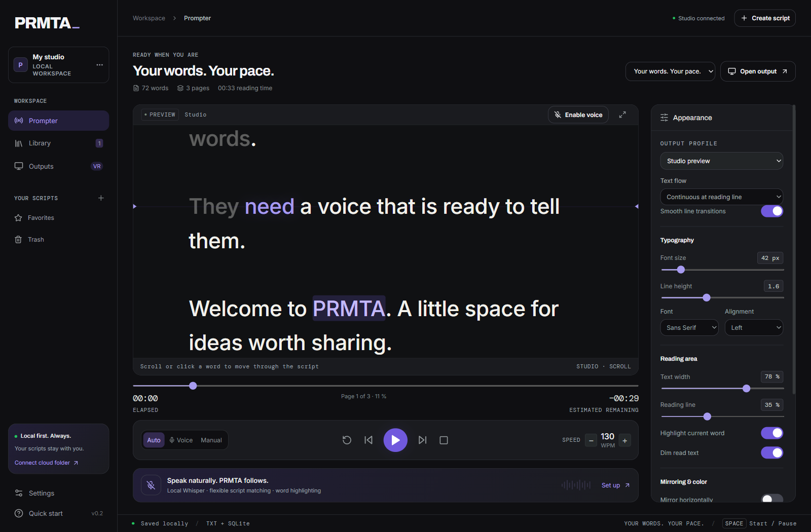
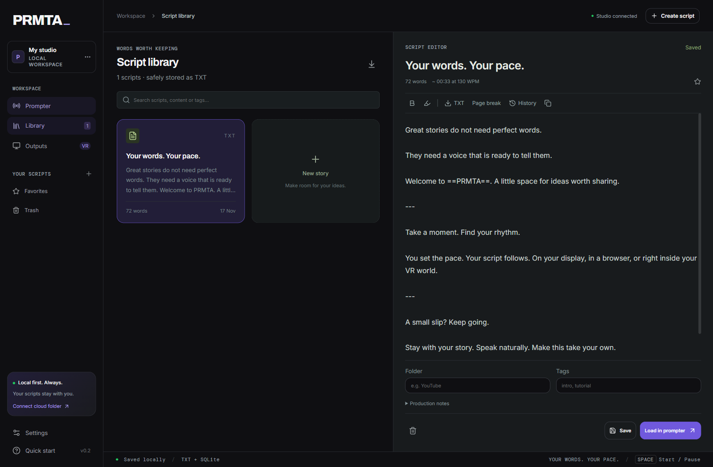

# PRMTA

**Your words. Your pace.** A local-first teleprompter studio for Windows, external displays, browsers and VR.

[Download the Windows app](https://github.com/DSuzuki35/PRMTA/releases/latest) · [User guide](docs/USER-GUIDE.md) · [Voice & models](docs/VOICE.md) · [Development](docs/ARCHITECTURE.md)



## What it does

- **External displays:** dedicated fullscreen output on any Windows monitor, including Elgato Prompter.
- **Browser and OBS:** clean, synchronized output with adjustable background opacity and mirroring.
- **VR:** transparent OpenKneeboard Web Dashboard output with an independent appearance profile.
- **Local voice follow:** bundled multilingual Whisper Base, forgiving nearby script alignment, current-word highlighting, and selectable Tiny, Small, quantized Small and quantized Large v3 Turbo models.
- **Your pace:** timed WPM scrolling, voice following or manual navigation; continuous reading-line and page-by-page layouts, optional smooth line transitions and wheel navigation.
- **Script library:** UTF-8 TXT revisions, SQLite indexing, folders, tags, favorites, search, autosave, draft recovery, version history and reversible trash.
- **Cloud folder sync:** use a local Dropbox, OneDrive or iCloud Drive folder; preserve revisions and surface conflicting edits.
- **Control options:** keyboard shortcuts, mapped gamepad/joystick buttons, keyboard foot pedals and an optional phone remote over your private LAN.
- **English interface:** designed with the [Dan Suzuki UI Kit](https://dansuzuki.com/ui-kit/), with locally bundled fonts. Script content can remain in its original language.

## Get started

1. Download `PRMTA-0.2.1-Windows-x64.exe` from [Releases](https://github.com/DSuzuki35/PRMTA/releases/latest).
2. Run it and choose **Try a sample** or **Create script**.
3. Press **Play**. For voice following, click **Enable voice** above the preview, then Play.
4. In **Outputs**, choose an external monitor, copy a browser link or add the VR link to OpenKneeboard.

The portable Windows x64 build includes the local CPU speech engine and Base model. It extracts at launch; allow a moment for the first start. No account or API key is required. The executable is not code-signed. The application stores persistent scripts and preferences in the Windows application profile, not next to the portable executable.

PRMTA 0.2.0 preserves the existing PRMPT 0.1 profile when available. The old `.prmpt.json` sidecar extension is intentionally retained for cloud compatibility.

## Write naturally

```text
Welcome to ==PRMTA==.

This is **important**. Take a breath.

---

A new page, a new thought.
```

Import TXT, Markdown or DOCX. Export plain UTF-8 TXT. `---` (or `\---`) on its own line starts a new page. Select **Continuous at reading line** to keep the current word at your chosen position, or **Page by page** to advance complete pages. Voice follow works with both.



## Choose a speech model

Start with **Base** for low overhead. Try **Small Q5** when you need more accurate multilingual recognition, or **Large v3 Turbo Q5** on more powerful hardware. Bigger models can add too much latency on CPU. Model file size is not a promise about runtime speed or memory use.

Optional models install from Settings with progress and SHA-256 verification. A compatible external whisper.cpp server can use other models or GPU acceleration. Browser speech recognition is also offered, but depends on the browser and may use an online service. Read the [voice guide](docs/VOICE.md) for setup, tradeoffs and the exact endpoint contract.

## Documentation

| Guide | Contents |
| --- | --- |
| [User guide](docs/USER-GUIDE.md) | Editing, formatting, displays, OBS, OpenKneeboard, shortcuts, controllers, remote and cloud folders. |
| [Voice & models](docs/VOICE.md) | Model choices, local recognition, downloads, external servers and troubleshooting. |
| [Architecture & development](docs/ARCHITECTURE.md) | Components, storage format, compatibility, security boundaries, build and test commands. |
| [Verification](docs/verification.md) | Release checks, Claude Code review, and what still requires physical hardware testing. |
| [Changelog](CHANGELOG.md) | Release changes. |

## Build from source

Windows x64, Node.js 24 LTS, npm:

```powershell
npm ci
npx playwright install chromium
npm run build
npm test
npm run test:e2e
npm run dev
```

For speech and a distributable build:

```powershell
powershell -ExecutionPolicy Bypass -File scripts/setup-whisper.ps1
npm run package
npx electron-builder --win portable
```

`npm run serve` starts the browser studio after a build. Model downloads and native display selection are desktop features; configure an external local Whisper server for the standalone browser host.

## Scope and privacy

PRMTA keeps scripts and default speech recognition local. Cloud-folder contents are uploaded by the cloud client you choose. Optional model downloads use the official whisper.cpp model repository. LAN sharing is opt-in and intended for trusted private networks; output and remote links are access credentials.

This release uses OpenKneeboard for VR rather than shipping a native OpenXR layer. It does not integrate Wispr Flow, promise semantic paraphrase tracking, or provide a built-in GPU runtime. Physical Elgato/VR/controller combinations require testing on your hardware. See [verification](docs/verification.md).

The source is public for inspection. No general open-source license has been assigned to PRMTA itself. Third-party components retain their own licenses; see [third-party notices](THIRD-PARTY-NOTICES.md) and [licenses](licenses).
