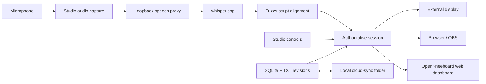

# Architecture and development

## Components

| Location | Responsibility |
| --- | --- |
| `electron/` | Secure desktop shell, native displays, owned Whisper process, verified model downloads. |
| `server/host.ts` | Loopback HTTP API, optional LAN listener, authentication and websocket distribution. |
| `server/library.ts` | SQLite revision index, TXT publication, cloud-folder reconciliation and conflicts. |
| `server/session.ts` | Authoritative take state, clock, countdown, playback and voice alignment. |
| `shared/` | Validated models, Unicode tokenization, explicit pages, fuzzy matching and model catalog. |
| `src/` | React studio, editor, output, remote and microphone capture. |
| `tests/` | Unit/integration and real Chromium workflow regression tests. |

The desktop studio talks to its local host. Display, browser and OpenKneeboard views subscribe to the same session. A single server clock advances timed playback; clients animate the text toward the current word. The studio, display and VR appearance profiles are separate.



Voice highlighting has a separate server-side `VoicePacing` estimate in `shared/voice-pacing.ts`. Local audio capture sends compact, admin-only `voiceActivity` heartbeats tied to the transport revision. The existing 100 ms session tick publishes `voiceHighlight`; it never feeds back into `position` or the matcher. Clients clamp it to the current page and can disable it per profile. Recognition consumes correctly predicted progress and resets wrong or stalled guesses; audio freshness and match expiry bound prediction. Only confirmed positions dim read text and drive scrolling/pagination.

## Data and compatibility

Each script has a UUID; each immutable revision has its own UUID, parent revision IDs, timestamp, title, content, tags, folder, favorite/trash flags and notes. Heads are revisions not named as parents. Multiple heads represent a conflict. Save checks expected heads to reject stale edits. Restore creates a new revision with all current heads as parents.

TXT is published before its JSON metadata sidecar, using a temporary file and rename. Sync retries incomplete cloud deliveries and validates IDs, content limits, parent relationships and collisions. Cyclic or cross-script chains are rejected. Missing parents may arrive later. The `.prmpt.json` extension and internal `prmpt` websocket/storage identifiers remain stable so 0.1 data can be used by PRMTA. Public branding is PRMTA.

New desktop profiles use `%APPDATA%\PRMTA`. When no new profile exists, the app reuses an existing `%APPDATA%\PRMPT` profile. It does not move or delete it. `PRMTA_DATA_DIR` changes the library location; the legacy `PRMPT_DATA_DIR` is also accepted. `PRMTA_PROFILE_DIR` isolates the full Electron profile for smoke tests. The standalone server defaults to `.prmpt` in the checkout for compatibility and accepts `PRMTA_DATA_DIR`.

Library lists cache parsed heads and invalidate on local inserts or SQLite's `data_version` changes. Loading one script uses an indexed query. Voice matching caches tokenization and searches a nearby window. Prompter rendering uses a viewport-sized word window and stops its animation loop when settled. Page fitting searches for a stable maximum size. Transport revisions invalidate speech captured before navigation, including remote commands. Prompter formatting is precomputed per script; memoized word components avoid rebuilding unchanged word DOM on each tick. Revision graph validation uses an explicit stack to support deep histories.

Cloud scanning remains synchronous and reads revision files every five seconds to retain collision detection. Very large histories can stall the host during reconciliation. No claim of unlimited library size is made; asynchronous/incremental sync is a future improvement.

## Security boundaries

Electron enables sandboxing, context isolation and disables Node integration in renderers. Only the studio window can use the narrowly scoped preload bridge. Output windows have no preload bridge. External navigation is blocked; opening a browser is limited to local output/remote routes.

The host binds to loopback by default. LAN sharing requires a deliberate action and starts a separate listener. Persistent random tokens distinguish admin, read-only output and playback remote. Admin is restricted to loopback even on the LAN listener. Tokens are supplied as URL fragments and then HTTP authorization headers/websocket subprotocols. Output and remote preferences exclude private library paths.

Model IDs come from a fixed enum. Downloads use fixed HTTPS artifact URLs, bounded size and SHA-256 verification, then an atomic publish. Optional models are data, not executable downloads. The packaged speech executable is separately pinned by the setup script. A model manager only terminates its own child process.

## Build and test

Use Node.js 24 LTS and npm on Windows x64. Node's built-in SQLite is required. Electron supplies its own Node runtime for the packaged app.

```powershell
npm ci
npx playwright install chromium
npm run build
npm test
npm run test:e2e
npm run dev
```

`npm run dev` launches the built application; rebuild after source changes. For the browser host, run `npm run serve` after building and open the printed studio link. `PORT` can override 4317. Electron automatically falls back to a free local port if 4317 is occupied.

```powershell
powershell -ExecutionPolicy Bypass -File scripts/setup-whisper.ps1
npm run package
npx electron-builder --win portable
```

The first packaging command produces `release/win-unpacked`; the second builds the portable executable. The download requires network access. Release output, models, dependencies, credentials and test profiles must not be committed.

Additional checks:

```powershell
node scripts/electron-smoke.mjs
npx tsx scripts/visual-check.ts
node scripts/documentation-screenshots.mjs
# With an independently running local server and the documented JFK fixture:
npx tsx scripts/voice-smoke.ts
```

The voice smoke script uses a synthetic microphone backed by an audio fixture; it does not record the developer's microphone. Screenshots use temporary sample libraries and mask access links and machine-specific paths. See [verification](verification.md) for results and hardware coverage limits.

## Design system

The interface follows the [Dan Suzuki UI Kit](https://dansuzuki.com/ui-kit/): `#0f0f12` background, `#1a1b1f` and `#25262c` surfaces, `#32343c` borders, purple `#7059dd` actions, readable `#a79bf0` accent text, Inter body, Archivo headings, and DM Mono labels. Cards use 16 px radii and controls 12 px. Fonts are bundled locally; no runtime font service is used. The prompter itself retains user-selected typography and colors.
