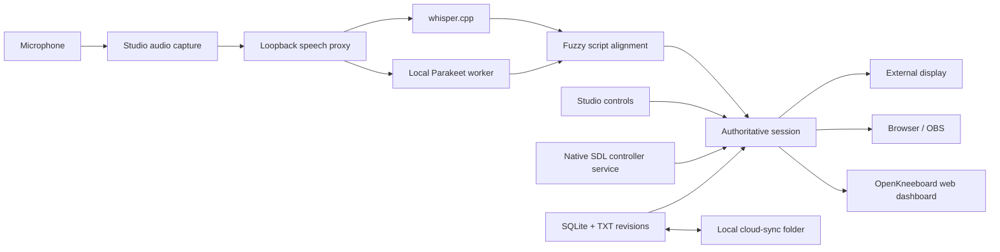

# Architecture and development

## Components

| Location | Responsibility |
| --- | --- |
| `electron/` | Secure desktop shell, native displays/controllers, owned Whisper and Parakeet processes, verified downloads and application updates. |
| `server/host.ts` | Loopback HTTP API, optional LAN listener, authentication and websocket distribution. |
| `server/library.ts` | Local SQLite revision index, immutable TXT history and legacy revision validation. |
| `server/cloud-library.ts` | Current cloud TXT files, metadata, bidirectional reconciliation and backed-up legacy migration. |
| `server/session.ts` | Authoritative take state, clock, countdown, playback and voice alignment. |
| `shared/` | Validated models, Unicode tokenization, explicit pages, fuzzy matching and model catalog. |
| `src/` | React studio, editor, output, remote and microphone capture. |
| `tests/` | Unit/integration and real Chromium workflow regression tests. |

The desktop studio talks to its local host. Display, browser and OpenKneeboard views subscribe to the same session. A single server clock advances timed playback; clients animate the text toward the current word. The studio, display and VR appearance profiles are separate.



Voice highlighting has a separate server-side `VoicePacing` estimate in `shared/voice-pacing.ts`. Local audio capture sends compact, admin-only `voiceActivity` heartbeats tied to the transport revision. The existing 100 ms session tick publishes `voiceHighlight`; it never feeds back into `position` or the matcher. Clients clamp it to the current page and can disable it per profile. Recognition consumes correctly predicted progress and resets wrong or stalled guesses; audio freshness and match expiry bound prediction. Only confirmed positions dim read text and drive scrolling/pagination.

## Native controllers and voice continuity

`electron/controller-service.ts` polls in the main process every 25 ms. `electron/controller-sdl.ts` loads @kmamal/sdl 0.11.13 and SDL 2.32.8 with `SDL_JOYSTICK_ALLOW_BACKGROUND_EVENTS=1` before initialization. Recognized gamepads use standard browser-compatible button ordering, including shoulders 4/5; generic devices retain up to 128 raw buttons. `controllerState` supplies the same snapshots to assignment capture, avoiding separate browser/native numbering during setup.

The service reuses `GamepadInput` and calls the host's trusted `dispatchCommand` path. Native held scrolling sends its own 200 ms heartbeats; the 600 ms session lease stops movement if heartbeats disappear. Renderer timers and window focus are not required to keep a native hold alive. Settings, typing and dialogs suspend actions while the main window is focused; assignment always suspends them. When background input is disabled, blur also suspends controls. Renderer reload/crash invalidates its UI context until a fresh trusted `controllerContext` call arrives. Device loss and shutdown stop held scrolling.

`gamepadKeepVoiceActive` defaults to true. Navigation preserves playback only when a Voice take is already active. During a held scroll the session ignores transcripts and voice-pacing activity; release or lease expiry changes the transport revision before fresh speech can resume. Manual control still pauses timed playback. No controller action implicitly enables the microphone or restarts an explicitly paused take.

## Optional Parakeet runtime

The Windows x64 app offers Parakeet TDT 0.6B v3 INT8 alongside Whisper. `shared/parakeet-manifest.json` pins the ONNX model revision, private Python runtime and wheel artifacts by URL, size and SHA-256. Setup downloads about 731 MB into the application profile, verifies complete files, prepares a staging runtime and publishes it only after an import check. Cancellation retains complete verified downloads for retry.

`electron/parakeet.ts` owns a hidden local worker with bounded line-based request/response handling. Audio is mono PCM16 WAV at 16 kHz. Only one transcription runs at a time. The model stays loaded between chunks; CPU is the default processor, with optional ONNX Runtime DirectML. First startup includes model loading and warmup. Runtime downloads happen during explicit setup; worker inference uses local model files with offline mode enabled. The UI reports the active processor and requires microphone reconnection after voice-setting changes.

## Data and compatibility

Each script has a UUID; each immutable revision has its own UUID, parent revision IDs, timestamp, title, content, tags, folder, favorite/trash flags and notes. Heads are revisions not named as parents. Multiple heads represent a conflict. Save checks expected heads to reject stale edits. Restore creates a new revision with all current heads as parents.

Local history retains immutable TXT and JSON revision pairs. Each cloud folder has its own local SQLite cache under `workspaces/<folder hash>`; tokens and preferences remain in the original local library. The cloud folder itself has one current TXT per active script plus `.prmta/library.json` for current metadata. Cloud saves reconcile first, reject stale revision heads, and persist a local write-ahead recovery record before publishing current text and metadata. Interrupted renames resume with the same identity and metadata. If recovery conflicts with a newer external edit, the pending draft moves to a local recoverable-drafts queue and the write journal is cleared so reconciliation can continue; admin-only endpoints export or restore a separate copy. External TXT edits create local history; external deletion moves the cached script to local trash. Missing folder/read errors abort reconciliation instead of treating the entire library as deleted.

`POST /api/workspace` requires an explicit `copyCurrent` choice. Ordinary preference writes cannot switch cloud folders. Scripts returned to the studio carry a workspace identity; stale editor saves to another workspace return 409. Switching resets the loaded take and keeps the original library available. Cached drafts include the cloud workspace identity.

Previously configured cloud folders require explicit approval before conversion. Legacy revision pairs are validated, imported into local history, copied to a verified local backup, and replaced by current TXT files. A locally persisted cleanup plan resumes removal of exact validated legacy files after interruption. Current text that differs from a partly migrated legacy head stops migration rather than being overwritten. Internal `prmpt` websocket/storage identifiers remain compatible; converted cloud folders require PRMTA 0.2.5 or newer.

New desktop profiles use `%APPDATA%\PRMTA`. When no new profile exists, the app reuses an existing `%APPDATA%\PRMPT` profile. It does not move or delete it. `PRMTA_DATA_DIR` changes the library location; the legacy `PRMPT_DATA_DIR` is also accepted. `PRMTA_PROFILE_DIR` isolates the full Electron profile for smoke tests. The standalone server defaults to `.prmpt` in the checkout for compatibility and accepts `PRMTA_DATA_DIR`.

Library lists cache parsed heads and invalidate on local inserts or SQLite's `data_version` changes. Loading one script uses an indexed query. Voice matching caches tokenization and searches a nearby window. Prompter rendering uses a viewport-sized word window and stops its animation loop when settled. Page fitting searches for a stable maximum size. Transport revisions invalidate speech captured before navigation, including remote commands. Prompter formatting is precomputed per script; memoized word components avoid rebuilding unchanged word DOM on each tick. Revision graph validation uses an explicit stack to support deep histories.

Cloud scanning remains synchronous, checking current TXT files every five seconds and reusing content when file size and timestamps are unchanged. Invalid individual TXT files are reported without deleting their cached script or blocking valid scripts; malformed shared metadata fails closed. Very large folders can stall the host during reconciliation. No claim of unlimited library size is made; asynchronous/incremental sync is a future improvement.

## Security boundaries

Electron enables sandboxing, context isolation and disables Node integration in renderers. Only the studio window can use the narrowly scoped preload bridge. Output windows have no preload bridge. External navigation is blocked; browser opening accepts local output/remote routes and a separate fixed official release-page action.

The host binds to loopback by default. LAN sharing requires a deliberate action and starts a separate listener. Persistent random tokens distinguish admin, read-only output and playback remote. Admin is restricted to loopback even on the LAN listener. Tokens are supplied as URL fragments and then HTTP authorization headers/websocket subprotocols. Output and remote preferences exclude private library paths.

Model IDs come from a fixed enum. Downloads use fixed HTTPS artifact URLs, bounded size and SHA-256 verification, then an atomic publish. Whisper model downloads are data; its packaged executable is separately pinned by the setup script. Optional Parakeet setup also downloads a private executable Python runtime and dependencies from its pinned manifest. The renderer cannot supply arbitrary download or executable URLs. Process managers terminate only the child processes they own.

## Build and test

Use Node.js 24 LTS and npm on Windows x64. Node's built-in SQLite is required. Electron supplies its own Node runtime for the packaged app.

```powershell
npm ci
npx playwright install chromium
npm run build
npm test
npm run test:e2e
npm run dev
```

`npm run dev` launches the built application; rebuild after source changes. For the browser host, run `npm run serve` after building and open the printed studio link. `PORT` can override 4317. Electron automatically falls back to a free local port if 4317 is occupied.

```powershell
powershell -ExecutionPolicy Bypass -File scripts/setup-whisper.ps1
npm run package
npx electron-builder --win nsis portable --x64 --publish never
```

The first packaging command produces `release/win-unpacked`; the second builds the Windows x64 NSIS installer and portable executable, plus update metadata. The download requires network access. Release output, models, dependencies, credentials and test profiles must not be committed.

The SDL dependency installs a prebuilt Node-API binding and adjacent SDL2 DLL. Its install script is explicitly allowed in `package.json`; packaging unpacks `node_modules/@kmamal/sdl/dist/**` from ASAR so Windows can load both native files. `npmRebuild` is disabled for the verified prebuilt runtime. Recheck native loading after Electron or SDL upgrades. Parakeet setup resources are packaged with the app; its approximately 731 MB model/runtime payload is downloaded only when the user requests setup.

## Windows application updates

The NSIS installation uses `electron-updater` and the public `DSuzuki35/PRMTA` GitHub release feed, following the [electron-builder update workflow](https://www.electron.build/v26/docs/features/auto-update/). Publish the Setup executable, its `.blockmap`, and `latest.yml` together with the matching release tag. The portable executable is an additional manual download; it is not the installer referenced by `latest.yml`. Before publishing, compare the update manifest's size and SHA-512 with the final installer bytes and verify the uploaded assets.

The main process owns discovery, background download and installation. The renderer receives status/progress and exposes fixed check/install actions through the trusted desktop bridge. It cannot provide an arbitrary update URL. New checks defer during an active take and retry after five minutes; an already-started transfer is not interrupted. Installation is user initiated, with pending editor work checked before restart. Transport commands are rejected during handoff so a remote cannot restart playback between the readiness check and shutdown. The ordinary library and model shutdown path must complete before installer handoff. Development and portable builds explain their manual update path instead of attempting to update themselves.

Keep `appId` (`studio.prmpt.app`), the product name (`PRMTA`) and profile compatibility stable across releases. The distribution is currently unsigned. Download integrity uses the updater's release metadata; this is not a claim of independent publisher signature verification.

Additional checks:

```powershell
node scripts/electron-smoke.mjs
npx tsx scripts/visual-check.ts
node scripts/documentation-screenshots.mjs
# With an independently running local server and the documented JFK fixture:
npx tsx scripts/voice-smoke.ts
```

The voice smoke script uses a synthetic microphone backed by an audio fixture; it does not record the developer's microphone. Screenshots use temporary sample libraries and mask access links and machine-specific paths. See [verification](verification.md) for results and hardware coverage limits.

## Design system

The interface follows the [Dan Suzuki UI Kit](https://dansuzuki.com/ui-kit/): `#0f0f12` background, `#1a1b1f` and `#25262c` surfaces, `#32343c` borders, purple `#7059dd` actions, readable `#a79bf0` accent text, Inter body, Archivo headings, and DM Mono labels. Cards use 16 px radii and controls 12 px. Fonts are bundled locally; no runtime font service is used. The prompter itself retains user-selected typography and colors.
