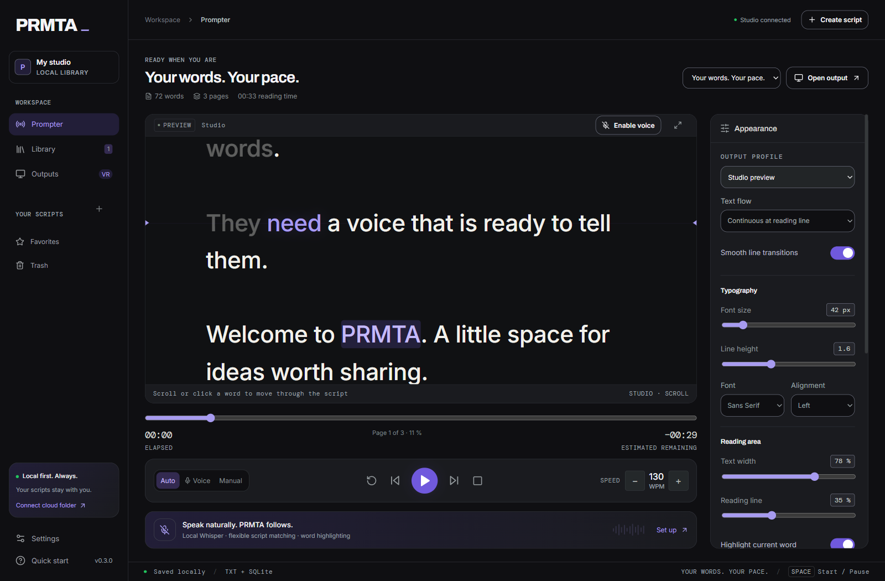
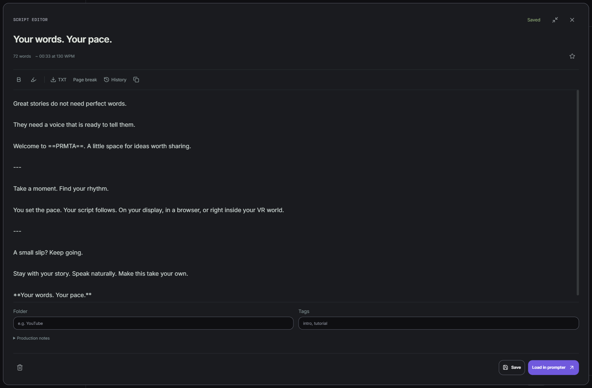
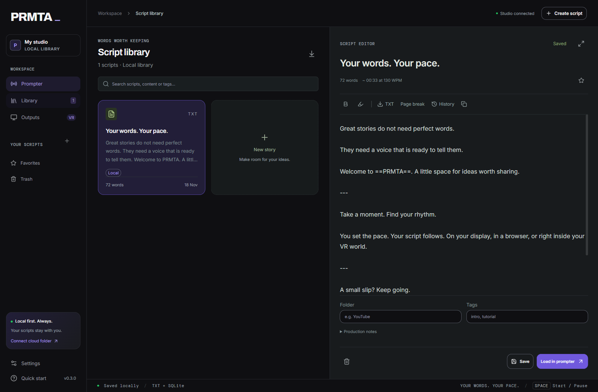
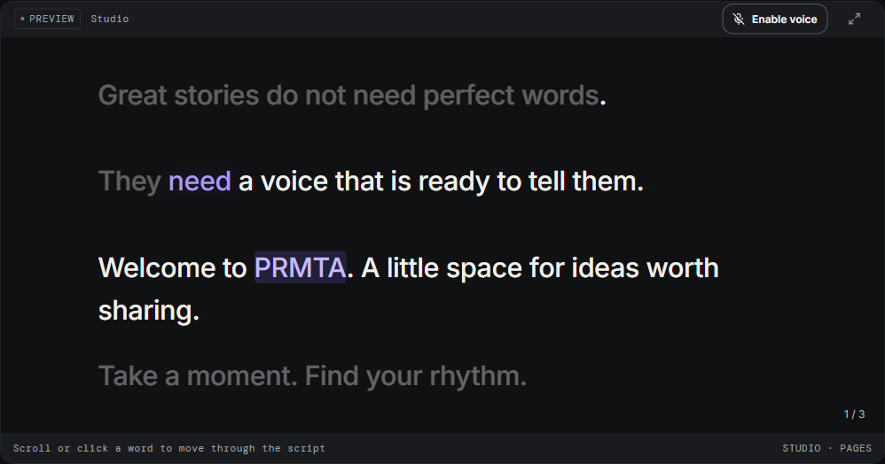
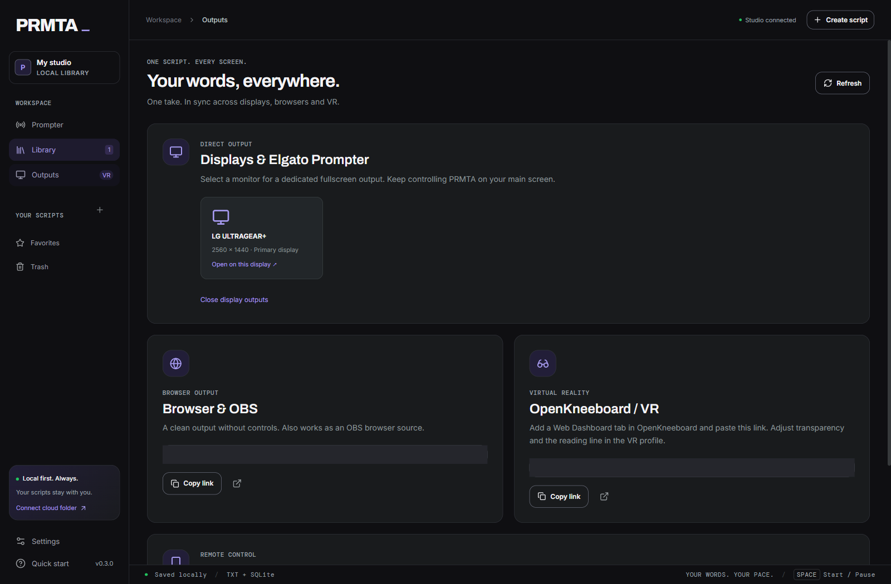
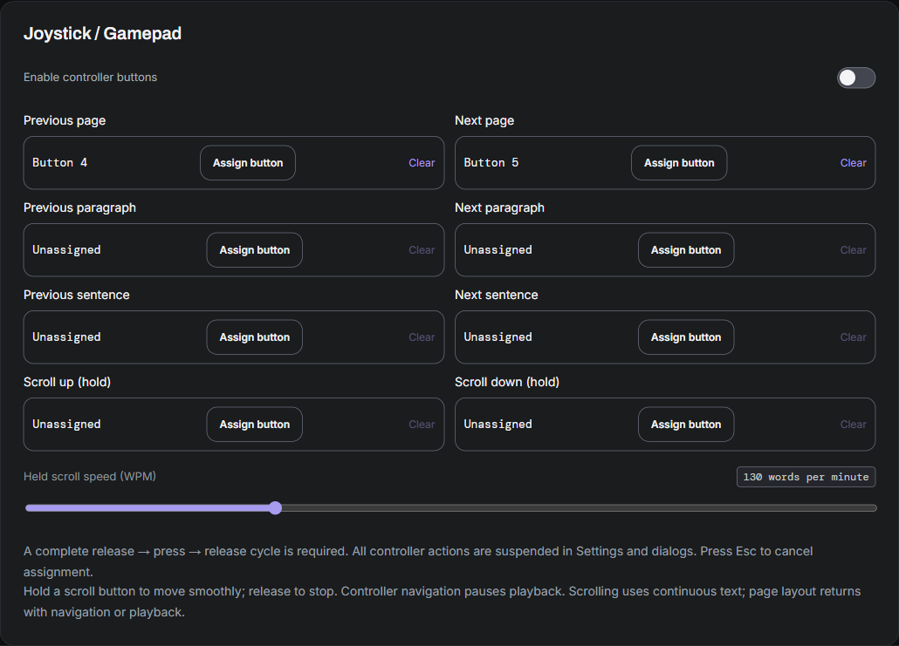
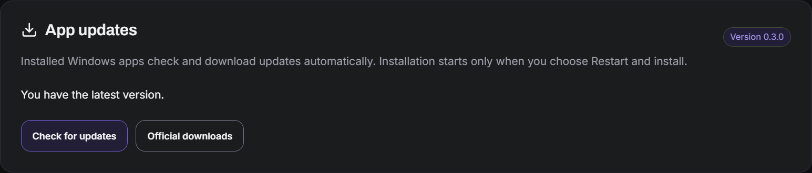
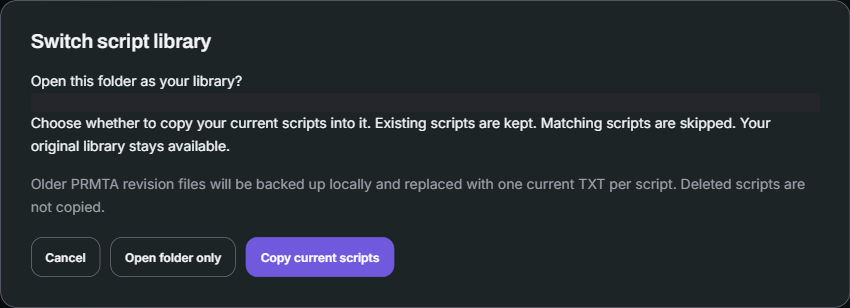

# PRMTA user guide

PRMTA is a Windows teleprompter studio with a local script library. The interface is English; scripts and local speech recognition support German and English. No account is needed.

## Your first take

1. Install and open PRMTA using the Windows x64 Setup download. A portable download is also available. Keep the application open during your take.
2. Click **Try a sample**, or **Create script** to write your own.
3. In **Library**, name the script, paste your text and click **Load in prompter**. Editing autosaves after a short pause. The save indicator confirms success.
4. Choose **Auto**, **Voice**, or **Manual**. Press **Play** or Space.
5. Open **Outputs** to send the same take to a display, browser or VR dashboard.



## Scripts and formatting

Scripts are stored as UTF-8 TXT revisions, with JSON metadata and a local SQLite index. Import `.txt`, `.md` or `.docx` using the import button in Library. DOCX imports plain text; rich Word layout is not preserved. Export the current text with **TXT** in the editor.

```text
Welcome to ==PRMTA==.

This is **important**. Speak at your own pace.

---

This starts a new page.
```

`==highlight==` marks important words, and `**bold**` adds emphasis. A line containing only `---` or `\---` starts a page; it is a page break rather than an ordinary line break. Use Enter for a line break and a blank line for a paragraph. Heading markers such as `# ` are hidden in the prompter. Other Markdown is treated as text. These markers remain intact in TXT exports.

Without explicit page separators, page mode packs complete sentences into pages of roughly 60 words. An overlong sentence can split at a comma, semicolon, colon or dash; text without usable punctuation stays intact. Common abbreviations and numeric decimal separators do not create page breaks. Explicit separators take precedence. In page mode, Font size is an upper limit: long pages shrink to the largest size that fits each output. Increasing the limit never makes text smaller. A size plateau means the page is full; add a page break or widen the reading area to make its text larger. Each browser source fits its own viewport dimensions.

Use **Expand editor** at the top right of the editor to fill the PRMTA window. **Esc** or **Exit expanded editor** returns to the library layout without losing the current draft. This does not enter operating-system fullscreen.



Use folders, comma-separated tags, favorites and search to organize scripts. Production notes do not appear in the output. Trash is reversible. **History** shows previous revisions. Restoring a revision creates a new version; it does not erase the old versions. Duplicate a script to create an independent copy.



An active take uses a snapshot of the loaded script. Editing the library does not change words on air. Load the script again when you want those edits to appear.

Unsaved drafts are backed up in the studio's local browser storage. If a save fails, retain the draft and export TXT or save it as a copy. A recovery cache complements version history; it is not a replacement for a backup.

Draft backups belong to the studio URL's origin. If port 4317 is occupied and PRMTA uses another port, drafts from the original origin will not appear there. Close the conflicting program and relaunch on the original port to recover them. Saved library revisions are independent of this port.

## Playback and appearance

| Mode | Behavior |
| --- | --- |
| Auto | Advances at the selected words per minute (WPM). |
| Voice | Advances only when recognized words match the script. Turn on the microphone and press Play. |
| Manual | Move with clicks, the progress slider, keyboard, remote or controller. |

There are three independent appearance profiles: **Studio preview**, **External display / browser**, and **VR / OpenKneeboard**. Select the profile in the inspector to edit its font size, line height, text width, reading line, alignment, colors, highlighting, dimming, mirroring and background opacity (0–100%). Background opacity does not fade the text. Transparent browser/OBS/VR output is supported; native monitor windows retain an opaque Windows surface.

**Smooth voice highlighting** under **Reading area** uses local microphone activity and your recent speaking pace to preview up to two words between Whisper results. Recognition corrects the estimate; silence stops its advance. The option is independent for each profile and does not change the confirmed position, mark guesses as read or turn a page early. It requires **Highlight current word** and local Whisper.

**Continuous at reading line** keeps the current word near the chosen vertical guide. Set the reading line to 50% for the middle. **Page by page** keeps the current page visible and changes pages as voice or timed playback progresses. Current-word highlighting works in either mode. In page mode, enable **Preview next line** to see the first line of the next page in muted gray below the current page. It is included in the fit calculation and disappears on the last page. **Smooth line transitions** in continuous mode animates line changes during playback; switch it off for immediate positioning. Loading a script always pauses at its first word, including the visible scroll position.

Scroll the mouse wheel over the preview to navigate, or click a word to jump there. Blackout hides output while preserving the take. The elapsed timer counts active playback; remaining time is an estimate using the current WPM. Countdown and loop are configured in Settings. Pausing stops progress; Reset returns to the beginning.



## Keyboard access and readability

Use Tab and Shift+Tab to move between controls. The first focusable link skips to the main content. Switches announce their on/off state and toggle with Space; sliders support the arrow keys. Focus rings remain visible in the dark theme and Windows forced-colors mode.

Quick start and Version history keep keyboard focus inside the dialog. Escape closes the dialog and returns focus to the opener. Playback shortcuts do not run while a dialog is open. Button state is exposed for voice, playback mode, blackout and favorites.

Control borders, muted interface text and click targets have been strengthened. Appearance colors and dimming remain user-configurable. Automated checks cover standard screens at 800 and 1440 pixels wide; they are not a complete accessibility certification or a replacement for assistive-technology user testing.

## Elgato Prompter and external displays

1. Connect the Elgato Prompter and confirm Windows recognizes it as an extended display. Install any display driver required by Elgato.
2. Open **Outputs → Displays & Elgato Prompter** and click that monitor.
3. PRMTA opens a separate fullscreen window on it. The studio remains on your main monitor.
4. Adjust the **External display / browser** profile. Enable horizontal mirroring only if your hardware needs it.
5. Press Escape in an output window, or **Close display outputs** in the studio, to close it.

The integration uses ordinary Windows displays. There is no dependency on Camera Hub for script control. PRMTA refreshes monitor geometry and closes an output if its display is disconnected.



## Browser, OBS and OpenKneeboard

**Browser:** Copy the Browser & OBS link, open it in a browser, move the window to the desired screen and use its fullscreen control. Keep PRMTA running. Local links work on the same computer.

**OBS:** Add a Browser Source and paste the same output link. Set the browser source dimensions to match your scene. Use transparency in the display profile if desired. The studio controls are not included in the output.

**VR:** Install [OpenKneeboard](https://openkneeboard.com/), add a Web Dashboard tab, and paste the OpenKneeboard / VR link. Set its placement and size in OpenKneeboard. PRMTA provides a transparent web output and requests a 1200 × 900 preferred dashboard size when the host API is present. Use the VR profile for readability and page flow. This release integrates through OpenKneeboard; it does not install its own native OpenXR API layer.

A disconnected browser keeps its last received position and shows a connection notice. Reopening/reconnecting the output restores the live session. Browser autoplay and microphone policies vary; use the desktop studio for reliable local voice capture.

## Phone remote and LAN sharing

Click **Share on local network**, then open a remote link on a device connected to the same trusted network. Allow PRMTA through Windows Firewall on private networks if necessary. The remote can control playback but cannot edit your script library. LAN output links are also available.

Links contain bearer access tokens: anyone with a remote link on the enabled network can control the take. Do not put them in screenshots or public streams. LAN transport is plain HTTP, intended for trusted private networks. **Stop network sharing** closes the listener and active LAN websocket connections. It does not rotate saved tokens; the same links may work again when sharing is re-enabled.

## Keyboard, joystick and foot pedals

| Shortcut | Action |
| --- | --- |
| Space | Play / pause |
| Page Up / Page Down | Previous / next page |
| Left / Right | Back / forward five words |
| Up / Down | Increase / decrease WPM by five |
| Home | Reset |
| B | Toggle blackout |
| F | Fullscreen |
| Escape | Pause in the studio; close a native display output |

Shortcuts work while the studio or remote has focus and you are not typing in a field. They are not system-wide shortcuts. Keyboard presenters and foot pedals can send these keys.

For controllers, enable **Enable controller buttons** in **Settings → Joystick / Gamepad**, connect the device, and press a button once so the browser can expose it. Eight actions can be assigned:

| Action pair | Behavior |
| --- | --- |
| Previous / next page | Jump to page boundaries, including explicit page separators. |
| Previous / next paragraph | Navigate paragraphs separated by blank lines. |
| Previous / next sentence | Navigate sentence boundaries. |
| Scroll up / down | Hold to scroll smoothly; release to stop. |

Previous and next page default to zero-based Gamepad API button indices 4 and 5 (commonly the shoulder buttons). The other actions begin unassigned. Click **Assign button**, then press and release the desired button. A full release → press → release cycle is required, so stuck or initially held buttons are ignored. A disconnect does not count as release. Escape cancels assignment. A button cannot be assigned to two actions; clear its existing assignment before moving it.

**Held scroll speed (WPM)** sets 20–400 words per minute, independent of the Auto playback speed. Manual controller navigation pauses the take so voice or timed playback cannot immediately pull it away. Previous/next jumps to the adjacent unit; Previous goes to the previous unit even if you are midway through the current one. At the first or last unit, navigation stays at that boundary.

Held scrolling temporarily uses continuous text, including on outputs configured for pages. A **Manual scroll** notice explains the temporary layout. Release stops at the current position; page layout returns on navigation, playback or reset. Controller navigation is suspended in Settings, while typing, and when a dialog is open. Lost focus or a disconnected controller stops held scrolling. Joysticks that do not expose a browser gamepad interface need a keyboard mapping utility.



## Application updates

Use the **Setup installer** to enable automatic Windows updates. The installed application checks GitHub shortly after startup and every six hours, and downloads an available update in the background. **Settings → App updates** shows the current version, progress and update status. Finish and pause your take, then choose **Restart and install** when the update is ready. Playback or held controller scrolling blocks installation. PRMTA waits for pending script saves; if a draft cannot be saved, reopen that script, resolve the error and save it before retrying.

Portable executables and development builds cannot install updates automatically. Existing portable users can download the Setup installer from [Releases](https://github.com/DSuzuki35/PRMTA/releases/latest), close the portable app and install PRMTA. The installer uses the same application profile, preserving saved scripts and preferences. You can also continue downloading portable versions manually.

Checks wait while playback or controller scrolling is active and retry after five minutes. A download already in progress can finish in the background. Update checks require an internet connection; script reading and local speech recognition do not. If a check or download fails, use the retry action in Settings. These Windows builds are unsigned.



## Cloud libraries and backup

Choose a local folder inside Dropbox, OneDrive or iCloud Drive in **Settings → Script library & cloud**. Install and sign into that service's own sync client first. Prefer a dedicated folder with files available offline. PRMTA does not sign in to cloud services itself.

Click **Open cloud library** and choose **Open folder only** or **Copy current scripts**. Opening only uses the scripts already there; it does not merge your local library automatically. Copying keeps existing scripts and skips matching ones. **Use local library** returns to the separate library on this computer without copying cloud scripts back. The sidebar and each script card identify the active storage location.



The cloud folder contains one current, human-readable `.txt` per active script. Renaming in PRMTA renames that file. New TXT files and edits made outside PRMTA are picked up automatically, normally within five seconds. Deleting a script in PRMTA removes its current cloud TXT; deleting the TXT externally moves the cached script to local Trash. Restore recreates its TXT. Files are flat in the selected folder; organizational folders in the editor are metadata, not filesystem subfolders.

Current metadata (identity, tags, notes and favorites) lives in `.prmta/library.json`. Keep that helper directory with the TXT files. The SQLite cache, version history and Trash stay on this computer, outside the cloud folder. History is not a shared cross-device archive. A missing or unreadable cloud folder does not erase the local recovery copy. If an interrupted save conflicts with a newer external edit, **Settings > Recovered drafts** lets you **Export TXT** or **Restore copy** without replacing the external version. PRMTA cannot confirm the provider has uploaded files online. Keep the cloud folder available offline and let the provider finish syncing before editing on another computer.

Older folders containing UUID-named revision TXT/JSON pairs wait for confirmation in the Open cloud library dialog, then are converted after a verified local backup. Only the current, non-deleted scripts remain as ordinary TXT files; the old revision files are removed from the cloud folder. Settings shows the backup location. Resolve any reported legacy revision conflicts before conversion. Do not use PRMTA 0.2.4 or older on a converted folder.

To back up the whole application, close PRMTA and copy its profile folder. New installations normally use `%APPDATA%\PRMTA`; upgrades can continue using `%APPDATA%\PRMPT`. Settings shows the actual library path. Copying while open requires handling SQLite WAL files correctly, so closing first is simpler.

## Troubleshooting

| Symptom | What to check |
| --- | --- |
| Voice does not advance | Microphone on, Voice mode, Play, countdown finished, correct script language, and words near the current position. Click the correct passage after a large jump. |
| Voice lags behind | Try Base or Tiny; use a closer microphone; close CPU-heavy apps. See the [voice guide](VOICE.md). |
| Model will not start | Download it first. If another app or server uses the Whisper port, choose a free **Whisper port** in Settings (e.g. 18080), click **Apply server**, then **Set up voice** and reconnect the microphone. |
| Blank/unauthorized browser output | Copy a fresh link from Outputs, including its `#token` fragment. |
| LAN device cannot connect | Same network, private-network firewall allowance, network sharing enabled, no Wi-Fi client isolation. |
| Cloud sync reports errors | Folder available offline and writable, valid `.prmta` metadata, and no older PRMTA instance writing legacy revisions into it. |
| Screen size changed | Refresh Outputs or reopen the output window after changing Windows display scaling. |
| Library changes do not appear on air | Load the edited script again; an active take deliberately keeps its original snapshot. |
