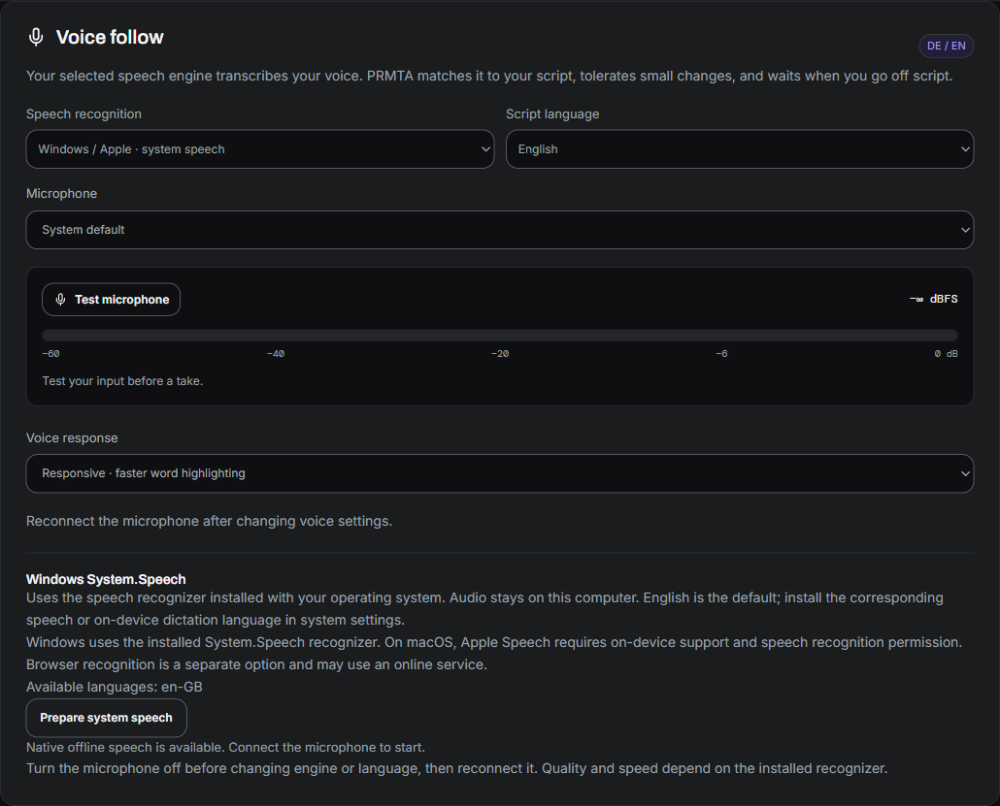
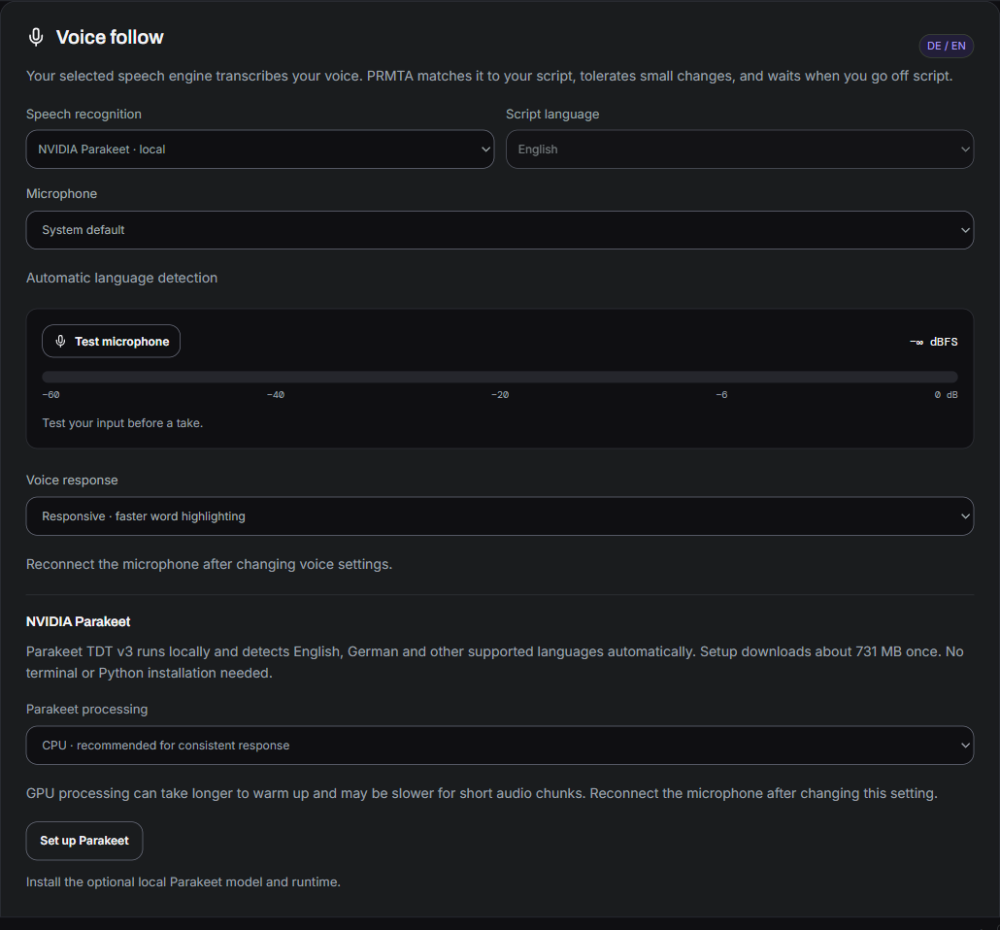
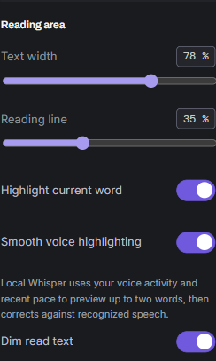
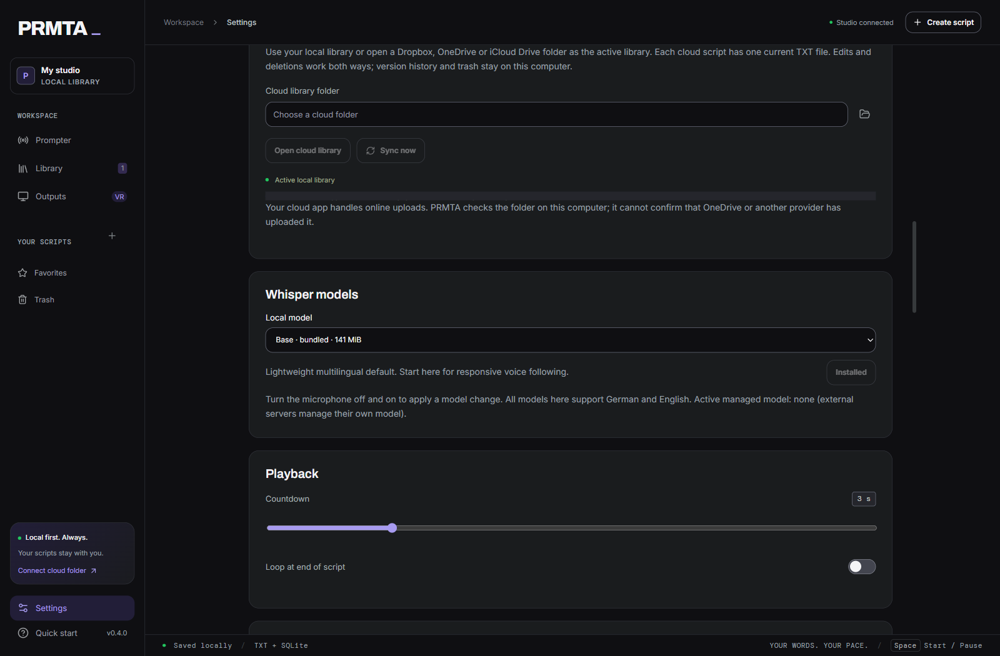

# Voice following and model selection

PRMTA separates speech recognition from script following. The selected engine turns short microphone windows into text. A bounded fuzzy alignment matches that text to nearby words in the script. Small omissions, fillers and slightly different wording are tolerated; arbitrary paraphrasing and large jumps are not guaranteed. At least three usable recognized words are required before matching advances. Forward matches must start near the current reading position (at most six omitted words, fewer for short phrases), and one result can advance at most 24 words. Distant accidental phrases are rejected instead of being used to seek. Earlier phrases never rewind playback. If you intentionally skip a larger passage, click the destination or use page navigation, then continue reading.

Recognition is local with Whisper, Parakeet or system speech. The microphone is resampled to 16 kHz mono WAV; Whisper uses the loopback whisper.cpp server, while Parakeet and system speech use private local workers. The default **Responsive** setting keeps approximately three seconds of overlapping audio and checks every 500 ms after the first second of speech. **Steady** uses five seconds and a 1,000 ms check interval. Only one inference request runs at a time; slow inference does not queue additional work. Silence is gated. Pausing a take stops script-follow inference and clears buffered speech; opt-in voice commands continue listening while the microphone is on. Resuming or loading a script starts following with fresh audio. Actual highlight latency includes audio collection, model processing and the words needed for a confident match. Whisper's request timeout is 20 seconds; Parakeet's transcription timeout is 60 seconds.

New profiles default to **English** for Whisper, system speech and browser recognition. Existing language preferences are retained. Parakeet uses automatic language detection and does not use the **Script language** selector.

## System speech: Windows and Apple

Select **Windows / Apple · system speech** in Settings. The status panel inventories installed languages without requesting microphone or speech permission. **Prepare system speech** initializes the selected engine; turning on the microphone also prepares it if needed. Both paths use your selected script language. Automatic uses English for this provider.

On Windows, PRMTA uses the installed [System.Speech recognizer](https://learn.microsoft.com/en-us/dotnet/api/system.speech.recognition.speechrecognitionengine?view=netframework-4.8). It processes audio locally through a private worker. Install a supported speech language in Windows if it is absent; Windows voice typing availability alone does not guarantee that System.Speech exposes that language. PRMTA lists the recognizers it can actually use.

The experimental macOS build uses Apple's Speech framework. It requires both [on-device recognition support](https://developer.apple.com/documentation/speech/sfspeechrecognizer/supportsondevicerecognition) and [on-device-only recognition requests](https://developer.apple.com/documentation/speech/sfspeechrecognitionrequest/requiresondevicerecognition). There is no online fallback. Apple speech permission is requested only when preparing or using the engine; microphone capture has its own permission. Missing permissions or language support produce an error. See [Mac build and device testing](MACOS.md).

The worker receives bounded in-memory WAV audio, not recordings saved to disk. Startup and inference speed depend on the installed recognizer and hardware. On our Windows fixture, the engine initialized quickly but recognition was considerably less accurate than Parakeet; system speech is an additional choice, not an accuracy upgrade. Test your own script before recording. The standalone browser host does not provide these desktop-native workers.



## Voice commands

Enable commands in **Settings > Voice commands** and connect the microphone. The default wake phrase is **prompta**, with **prmta** and **prompt a** accepted as recognition variants. A custom wake phrase uses its own exact wording. Commands are English independently of the script language.

| Say after the wake phrase | Action |
| --- | --- |
| play / start / resume | Start or resume playback. |
| pause / stop | Pause playback; keep the microphone listening. |
| reset / back to start | Return to the start. |
| next / previous | Move one page. |
| next / previous sentence, paragraph, page or chapter | Move the named unit. |
| faster / speed up; slower / slow down | Change playback speed by five WPM. |
| blackout / toggle blackout | Toggle hidden output. |
| voice mode / auto mode / timed mode / manual mode | Change reading mode. |

Leave at least a brief pause before and after each command (the local audio gate requires about 650 ms of quiet). PRMTA waits for the final phrase; an interim “prompta, next” cannot prematurely turn a page when you are saying “prompta, next sentence”. Repeated results from the same audio execute once. A new spoken command after silence can intentionally repeat the action. Command text is consumed separately from script matching, and results captured before a seek or mode change are discarded.

Commands listen while playback is paused only when enabled and the microphone is on. They are suspended while typing, in Settings or dialogs, while assigning controls and during manual held scrolling. Switching off the microphone stops all listening. A wake phrase embedded or quoted inside ordinary prose is not a command; avoid starting script sentences with your configured wake phrase. Unknown addressed commands do not advance the script.

## NVIDIA Parakeet (optional)



The Windows x64 app can install **Parakeet TDT 0.6B v3 · multilingual · INT8** as an alternative to Whisper. The model automatically detects 25 supported languages, including English and German. PRMTA uses an INT8 ONNX conversion with a private local runtime. See the [NVIDIA model card](https://huggingface.co/nvidia/parakeet-tdt-0.6b-v3) and [Ilya Stupakov's ONNX conversion](https://huggingface.co/istupakov/parakeet-tdt-0.6b-v3-onnx).

1. Turn off the microphone, then open **Settings > Voice follow > Speech recognition**.
2. Select **NVIDIA Parakeet · local**.
3. Keep **Parakeet processing** on **CPU · recommended for consistent response** and click **Set up Parakeet**.
4. Wait for download progress, verification and model startup. The initial download is about 731 MB, including the model and private runtime; unpacked disk use is larger. No terminal commands or separate Python installation are needed.
5. When **Parakeet ready** appears, enable voice in the studio and press Play.

On a clean Windows installation, Parakeet may also need the [Microsoft Visual C++ x64 runtime](https://learn.microsoft.com/en-us/cpp/windows/latest-supported-vc-redist). If it is missing, setup shows a **Get Microsoft Visual C++ runtime** button. Install the official Microsoft download, then retry Parakeet setup.

Setup downloads only when requested. Files have pinned URLs, sizes and SHA-256 hashes. **Cancel download** stops setup; retry reuses complete verified files. If installation succeeds but the engine is stopped, the button becomes **Start Parakeet**. The model and runtime remain in your application profile for later use. Recognition does not need an internet connection after setup.

**GPU · DirectML** is optional. CPU is the recommended starting point for short teleprompter audio windows; GPU startup can be longer and processing can be slower on some hardware. The status reports the active processor. Turn off the microphone before changing the processor, then reconnect it. If GPU startup fails or is too slow, select CPU and retry.

On the release-test machine, a warmed Parakeet CPU inference on a 2.2-second JFK speech fixture took about **63 ms**, compared with about **550 ms** for Whisper Base. These measurements cover backend processing on one fixture and machine. They exclude microphone collection, startup and script alignment, and do not promise that spoken words will highlight within those times. Test your own microphone, script and hardware before a take.

Parakeet is a desktop-managed provider. The standalone browser host does not install its runtime. Its recognition results use the same nearby script matching and stale-audio safeguards as Whisper.

## Smooth voice highlighting



In the studio inspector, select an **Output profile**, then use **Reading area > Smooth voice highlighting**. It is enabled by default, independently for studio, display/browser and VR. **Highlight current word** must also be enabled. Browser recognition retains recognition-driven highlighting because it does not supply the local waveform gate.

With local Whisper, Parakeet or system speech, PRMTA monitors the microphone waveform energy (RMS) with a short attack/release gate and noise-floor tracking, including stable room noise. After a script match, it can preview up to two upcoming words while audio remains active. It learns words per second from confirmed progress and voiced time over the last two minutes of the current take. Until enough observations exist, it uses a conservative initial pace. Very short recognition bursts and implausible rate samples do not train the estimate.

The estimate stops advancing during a pause, and lost audio heartbeats expire after 350 ms. New recognition corrects it, including moving the visual highlight back if the guess was wrong. After 2.5 seconds without a fresh matching result, it returns to the confirmed word. Reset, seek, mode changes and pause/resume clear the estimate and pace history. This is a visual aid: predicted words are not marked as read, do not steer speech matching and cannot turn a page. The reading guide and page changes still follow confirmed progress.

This is an energy gate, not a semantic voice-activity model: sustained background noise can look like speech. The two-word limit, recent-match requirement and corrections keep that effect bounded. It does not eliminate recognition latency. No additional audio recording, recognition request or external service is introduced.

## Voice following during controller navigation

In **Settings > Joystick / Gamepad**, **Keep voice follow active** is enabled by default. It preserves an already-playing Voice take when you jump to another page, paragraph or sentence. A held scroll temporarily takes priority over recognized speech; release resumes following at the new location using fresh audio. Results captured before the jump or during the hold cannot pull the script back afterward.

This option never turns on the microphone or starts a paused take. Explicit Pause, Reset and script changes remain authoritative. Turn the option off to pause the take on controller navigation. Timed Auto playback pauses regardless of this option. The separate **Controller input in background** option lets native Windows controller input work while another app is focused or PRMTA is minimized; browser-only controller input still requires focus.

## Included and downloadable Whisper models

The Windows release includes multilingual **Base** and the whisper.cpp CPU server. Additional models download only when requested in Settings, into the application profile's `models` folder. Files are installed after exact size and SHA-256 verification. A failed download can be retried; automatic resume is not implemented.

| Model | Download | Intended use |
| --- | ---: | --- |
| Tiny | 74 MiB | Lower latency on modest hardware, with reduced accuracy. |
| Base | 141 MiB | Included starting point for responsive local voice following. |
| Small Q5 | 181 MiB | Compact multilingual accuracy upgrade. |
| Small | 465 MiB | Full Small model; more storage and compute. |
| Large v3 Turbo Q5 | 547 MiB | Higher-capacity recognition; powerful hardware recommended. |

These are model file sizes, not RAM requirements. Q5 means quantized weights: a smaller file and memory footprint, with possible accuracy differences. It does not guarantee faster inference on every CPU. Larger models can be too slow for this application's short recognition cadence. Try Base first, then Small Q5 if pronunciation or background noise needs better recognition. Test latency on your own hardware before recording.



Select a model, download it if needed, then turn the microphone off and back on. PRMTA restarts only the server process it owns. It never kills an independently started server. If another Whisper server occupies the selected port, its model is controlled externally. A request to apply a different managed model reports that conflict instead of silently pretending to switch.

## Whisper port

In **Settings > Voice follow**, set **Whisper port** and click **Apply server**, then **Set up voice**. The default is 8080; use another free port, such as 18080, if another application already uses it. Ports must be whole numbers from 1 to 65535; reserved ports blocked by HTTP Fetch are rejected. The port is saved as part of **Local Whisper server**, so startup, connection checks and transcription use the same address after restart.

The Windows app automatically starts its bundled server at `127.0.0.1` on the selected port. Turn the microphone off before setup and reconnect afterward. A managed port change takes effect on the next setup or microphone reconnect; only PRMTA's previous server is stopped. An already active microphone keeps its previous address until reconnected. A port occupied by another application produces a port-conflict message. `localhost` and `[::1]` remain addresses for independently managed servers; selecting one does not stop an existing managed process, which closes when PRMTA exits.

For a guided setup, click **Set up voice** in Settings. It downloads the selected model when necessary, shows progress, verifies it and starts the included engine. When the button says **Voice ready**, enable the microphone in the studio and press Play. No terminal commands are needed in the Windows app. The commands below are only for developers running a source checkout.

After a forced app termination or system crash, an orphaned `whisper-server.exe` may remain. Close that process in Task Manager before requesting a managed model change. Normal shutdown stops the owned process and waits for model download cleanup.

The catalog uses fixed filenames and verified hashes from the [whisper.cpp model distribution](https://huggingface.co/ggerganov/whisper.cpp/tree/main). English-only `.en` variants, Medium, full Large v3, and full Turbo can be used with your own compatible whisper.cpp server. `.en` models are for English scripts, not German. OpenAI describes Turbo as an optimized Large v3 model; published speed comparisons should not be interpreted as a guarantee for the bundled CPU server. See [OpenAI's model table](https://github.com/openai/whisper#available-models-and-languages) and [whisper.cpp models](https://github.com/ggml-org/whisper.cpp/tree/master/models).

Other engines such as faster-whisper can be useful, particularly with a GPU, but their native Python API is not interchangeable with PRMTA's HTTP endpoint. An adapter must implement the contract below. Distilled models require careful compatibility and quality testing; PRMTA does not claim support for every Whisper derivative.

## External server contract

Set a local HTTP URL in Settings. Allowed hostnames are `127.0.0.1`, `localhost`, and `[::1]`. Remote cloud inference endpoints and URL credentials are rejected.

- `GET /health` returns HTTP 200 and JSON `{ "status": "ok" }`.
- `POST /inference` accepts multipart form data: `file` (WAV), `response_format=json`, `language=de|en|auto`, and `temperature=0`.
- The response contains a string `text` field.

For a source checkout on Windows:

```powershell
powershell -ExecutionPolicy Bypass -File scripts/setup-whisper.ps1
powershell -ExecutionPolicy Bypass -File scripts/start-whisper.ps1
# Optional: match a custom port configured in Settings
powershell -ExecutionPolicy Bypass -File scripts/start-whisper.ps1 -Port 18080
```

The setup script downloads pinned whisper.cpp v1.9.2 binaries and multilingual Base. The packaged app already includes these and starts its owned server when the microphone is enabled. The bundled Whisper binary uses CPU inference; Whisper GPU acceleration requires an external server. Parakeet's optional DirectML setting is independent of Whisper.

## Practical recording workflow

1. Choose the correct input device and script language. Click **Test microphone** for a live dBFS meter, peak hold and clipping indicator, then stop the test. Automatic detection may be less stable on very short chunks.
2. Use headphones when playing other audio; keep background speech away from the mic.
3. Start near the passage you intend to read, click **Enable voice** above the preview (or select **Voice**), then Play.
4. Give the recognizer a few words. Watch the recognized transcript and highlighted word.
5. If you skip a large section, click the new passage or use page navigation. If you go off script, PRMTA should wait rather than scroll blindly.
6. If a microphone is unplugged, reconnect it and turn capture on again. Permission errors are shown in the studio.

Browser speech recognition is optional and browser-dependent. It may use an online service and may be unavailable in Electron. Its Automatic language option uses English. Local Whisper is the Windows default; Apple system speech is the default for new Mac profiles. Local Parakeet is an optional Windows provider. PRMTA does not currently integrate the proprietary Wispr Flow application.
